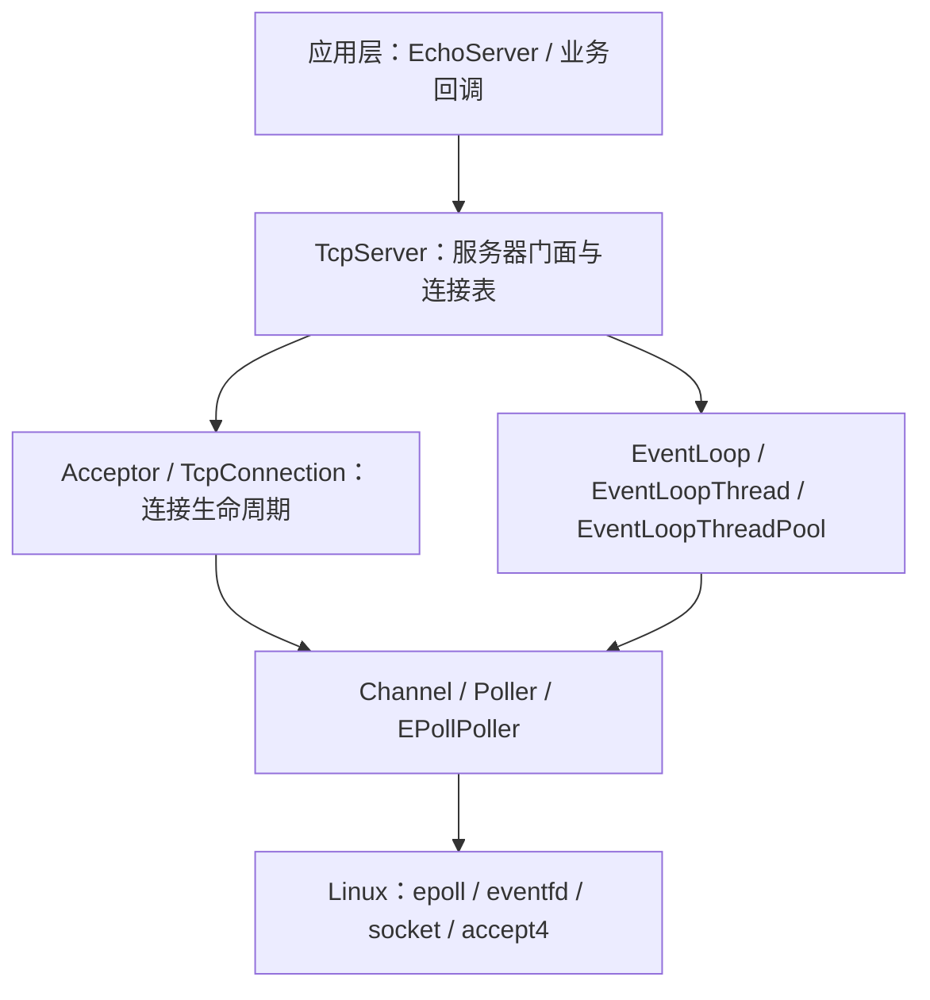
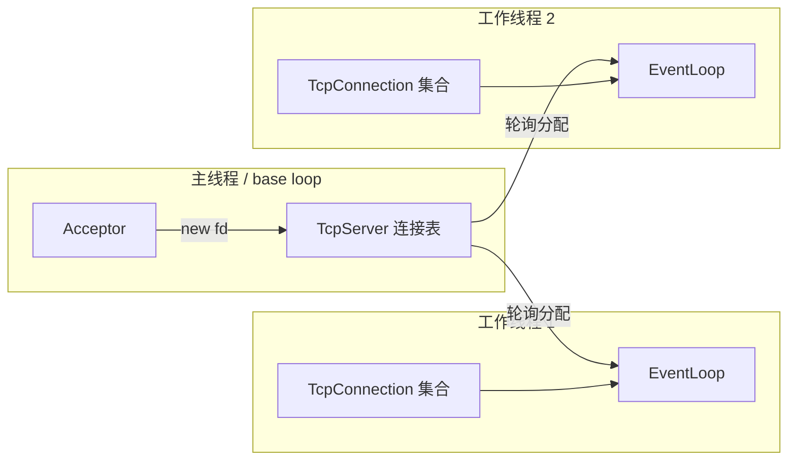
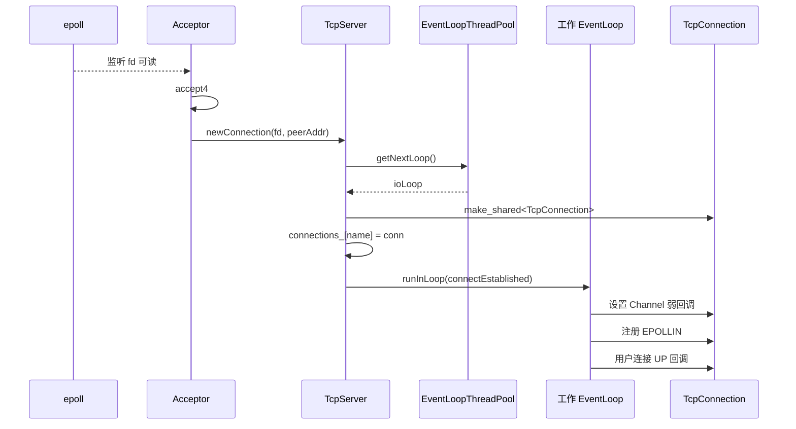
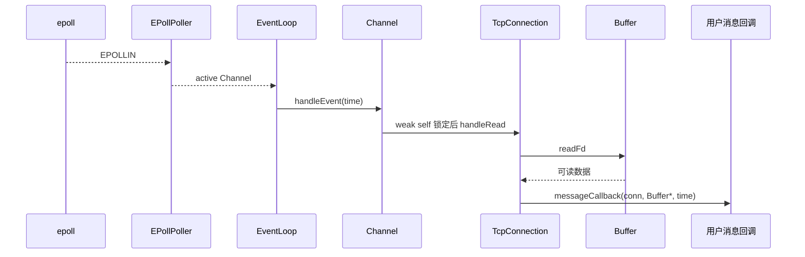
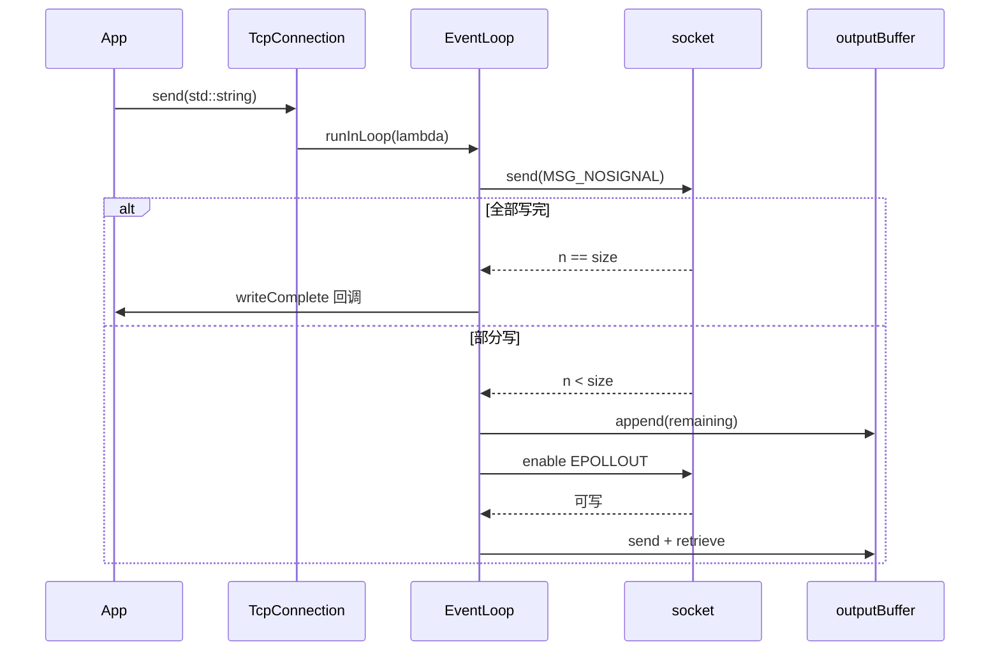
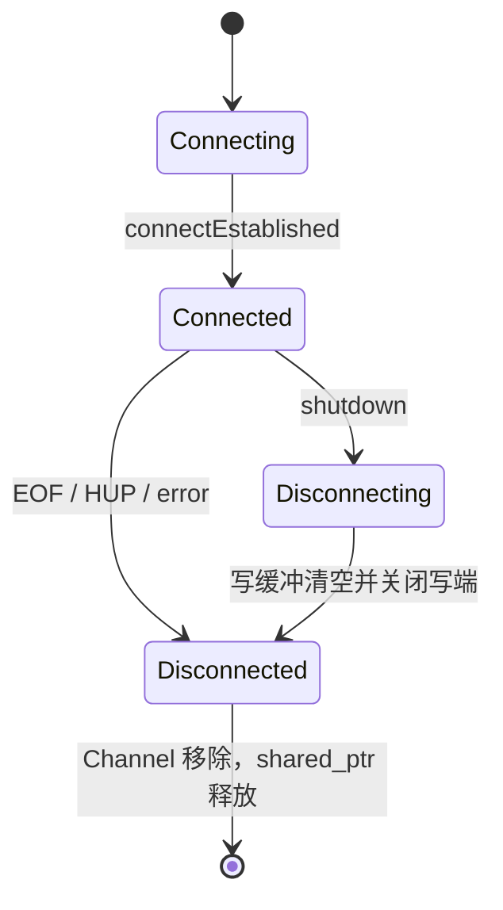

# my_muduo 重构后架构与运行流程

> 分析基线：`ee4eb4b`（2026-10-31）
> 适用范围：当前 C++17 源码、构建配置与 Echo 示例
> 历史文档：`architecture.md` 保留为重构前版本

## 1. 结论摘要

重构后的 `my_muduo` 仍然采用：

```text
Reactor
+ one loop per thread
+ level-triggered epoll
+ 主事件循环 accept
+ 工作事件循环管理已建立连接
```

本轮重构没有引入新的 Handler 或 Executor 类，而是降低了内部抽象层：

- Acceptor 直接调用所属 TcpServer。
- TcpConnection 直接调用所属 TcpServer。
- 应用层回调与 Channel 底层事件回调继续保留。
- TcpConnection 的所有状态变化和 socket 操作线程封闭。
- Channel 中 TcpConnection 的回调使用 `weak_ptr` 防止悬空和引用环。
- 跨线程 send/shutdown 使用拥有数据和连接所有权的 lambda。

当前代码已经解决了此前最直接的跨线程 send 悬空、Channel 回调自引用和关闭路径分散问题，但仍是教学型网络库。尚无应用层 parser、定时器、客户端、自动化测试和完整 Linux 运行验证。

## 2. 项目目录

```text
my_muduo/
├── CMakeLists.txt
├── README.md
├── autobuild.sh
├── include/my_muduo/
│   ├── base/
│   │   ├── CurrentThread.h
│   │   ├── Logger.h
│   │   ├── Thread.h
│   │   ├── Timestamp.h
│   │   └── noncopyable.h
│   └── net/
│       ├── Acceptor.h
│       ├── Buffer.h
│       ├── Callbacks.h
│       ├── Channel.h
│       ├── EPollPoller.h
│       ├── EventLoop.h
│       ├── EventLoopThread.h
│       ├── EventLoopThreadPool.h
│       ├── InetAddress.h
│       ├── Poller.h
│       ├── Socket.h
│       ├── TcpConnection.h
│       └── TcpServer.h
├── src/
│   ├── base/
│   └── net/
├── examples/
│   ├── CMakeLists.txt
│   └── echo_server.cpp
└── docs/
```

公开引用使用稳定的完整路径：

```cpp
#include <my_muduo/net/TcpServer.h>
#include <my_muduo/net/EventLoop.h>
#include <my_muduo/base/Logger.h>
```

## 3. 分层架构



### 3.1 模块职责

| 模块 | 职责 | 关键位置 |
|---|---|---|
| `TcpServer` | 对外门面、监听入口、连接表、用户回调配置 | `include/my_muduo/net/TcpServer.h` |
| `Acceptor` | 监听 socket、accept、直接交付给 TcpServer | `include/my_muduo/net/Acceptor.h` |
| `TcpConnection` | 单连接状态机、读写缓冲、发送和统一关闭 | `include/my_muduo/net/TcpConnection.h` |
| `EventLoop` | epoll 等待、Channel 分发、任务队列、线程断言 | `include/my_muduo/net/EventLoop.h` |
| `Channel` | fd、关注事件、返回事件和底层回调 | `include/my_muduo/net/Channel.h` |
| `Poller` | I/O 多路复用抽象 | `include/my_muduo/net/Poller.h` |
| `EPollPoller` | epoll 的注册、修改、删除和等待 | `include/my_muduo/net/EPollPoller.h` |
| `EventLoopThread` | 在独立线程创建并运行一个 EventLoop | `include/my_muduo/net/EventLoopThread.h` |
| `EventLoopThreadPool` | 轮询分配工作 EventLoop | `include/my_muduo/net/EventLoopThreadPool.h` |
| `Socket` | fd 与 socket 选项 RAII | `include/my_muduo/net/Socket.h` |
| `Buffer` | 输入/输出缓冲与 `readv/send` | `include/my_muduo/net/Buffer.h` |
| `Timestamp/Logger/Thread` | 基础时间和日志设施 | `include/my_muduo/base/` |

### 3.2 依赖方向

```text
TcpServer
  -> Acceptor
  -> EventLoopThreadPool
  -> TcpConnection

Acceptor
  -> TcpServer::newConnection()
  -> Channel -> EventLoop -> Poller

TcpConnection
  -> TcpServer::removeConnection()
  -> Channel -> EventLoop -> Poller

EventLoop
  -> Poller
  -> Channel 回调
  -> pendingFunctors_
```

## 4. 所有权模型

| 拥有者 | 拥有的对象 | 说明 |
|---|---|---|
| `TcpServer` | `unique_ptr<Acceptor>` | 监听器生命周期与服务器一致 |
| `TcpServer` | `unique_ptr<EventLoopThreadPool>` | 工作线程池 |
| `TcpServer` | `unordered_map<string, TcpConnectionPtr>` | 已建立连接的长期所有者 |
| `EventLoopThreadPool` | `vector<unique_ptr<EventLoopThread>>` | 工作线程 |
| `EventLoopThread` | `EventLoop` | EventLoop 位于线程函数栈上 |
| `EventLoop` | `unique_ptr<Poller>` | epoll 实例 |
| `EventLoop` | `unique_ptr<Channel> wakeupChannel_` | eventfd 唤醒通道 |
| `Acceptor` | `Socket`、`Channel` | 监听 fd 和监听事件通道 |
| `TcpConnection` | `unique_ptr<Socket>` | 连接 fd |
| `TcpConnection` | `unique_ptr<Channel>` | 连接 fd 的事件通道 |
| `TcpConnection` | 输入/输出 `Buffer` | 连接私有状态 |

非拥有关系：

| 持有者 | 非拥有对象 | 约束 |
|---|---|---|
| `Acceptor` | `TcpServer&` | TcpServer 必须晚于 Acceptor 销毁 |
| `TcpConnection` | `TcpServer&` | TcpServer 必须晚于连接清理任务 |
| `Channel` | `EventLoop*` | EventLoop 必须晚于 Channel 销毁 |
| `Poller` | `Channel*` | Channel 必须先移出 Poller |
| `EventLoopThreadPool` | `EventLoop*` | EventLoop 位于对应线程栈上 |

本轮没有引入新的生命周期接口。直接引用降低了调用链抽象，但也要求这些所有权约束必须长期成立。

## 5. 回调模型

### 5.1 保留的应用层回调

```cpp
using ConnectionCallback =
    std::function<void(const TcpConnectionPtr&)>;
using MessageCallback =
    std::function<void(const TcpConnectionPtr&, Buffer*, Timestamp)>;
using WriteCompleteCallback =
    std::function<void(const TcpConnectionPtr&)>;
```

TcpServer 提供：

```cpp
setConnectionCallback(...)
setMessageCallback(...)
setWriteCompleteCallback(...)
```

这些是业务扩展点，保持不变。

### 5.2 保留的 Channel 回调

Channel 被 EventLoop、Acceptor 和 TcpConnection 复用，因此保留：

```cpp
setReadCallback(...)
setWriteCallback(...)
setCloseCallback(...)
setErrorCallback(...)
```

Channel 不保存具体 owner 类型，避免通过 `void*`、枚举或新增接口进行强制解耦。

### 5.3 删除的内部回调

| 已删除 | 当前方式 |
|---|---|
| `Acceptor::newConnectionCallback_` | Acceptor 直接调用 `server_.newConnection()` |
| `TcpConnection::closeCallback_` | TcpConnection 直接调用 `server_.removeConnection()` |
| `HighWaterMarkCallback` | 当前删除；发送背压尚未重新设计 |
| `ThreadInitCallback` 三层链 | 当前删除 |

内部 `std::bind` 已全部替换为 lambda。

## 6. 线程模型



固定不变量：

1. 一个线程最多创建一个 EventLoop。
2. 一个 TcpConnection 永久属于一个 EventLoop 线程。
3. TcpConnection 构造后的运行期状态、Channel 和 Buffer 只在所属 IO 线程修改；初始状态由主 loop 构造阶段设置。
4. TcpServer 连接表在主 loop 线程修改。
5. 外部线程通过 EventLoop::runInLoop/queueInLoop 投递命令。
6. Channel 创建、修改和移除必须发生在它所属的 loop 线程。

`setThreadNum(0)` 时，新连接回退到主 EventLoop。

## 7. 启动流程

示例入口：

```cpp
int main() {
    EventLoop loop;
    InetAddress addr(8000);
    EchoServer server(&loop, addr, "EchoServer_01");
    server.start();
    loop.loop();
}
```

### 7.1 构造主 EventLoop

1. 创建默认 Poller，实际实现为 EPollPoller。
2. 创建 eventfd。
3. 创建 wakeup Channel。
4. 注册 wakeup Channel 读回调。
5. 把 wakeup fd 注册到 epoll。
6. 记录当前线程 ID，并设置 thread-local EventLoop 指针。

### 7.2 构造 TcpServer

1. 创建 Acceptor，监听地址在此完成 socket、bind 和事件通道初始化。
2. Acceptor 保存 TcpServer 引用。
3. 创建 EventLoopThreadPool。
4. 应用配置连接、消息和写完成回调。
5. 应用设置工作线程数量。

`setThreadNum()` 必须在 `start()` 前调用；当前已增加状态检查。

### 7.3 启动

`TcpServer::start()`：

1. 保证只启动一次。
2. 启动 EventLoopThreadPool。
3. 每个 EventLoopThread 创建自己的 EventLoop。
4. 向主 loop 投递 Acceptor::listen。
5. 主 loop 开始运行后注册监听 fd 的读事件。

## 8. 新连接流程



关键点：

- Acceptor 只负责 accept，不再通过 `std::function` 等待上层回调。
- TcpConnection 对象在主 loop 创建并放入连接表。
- 连接的事件注册和用户 UP 回调在工作 loop 执行。
- Channel 中保存的 TcpConnection 回调使用 `weak_ptr`。

## 9. 读事件流程



`Buffer::readFd()`：

1. 第一段 iovec 指向 Buffer 可写区域。
2. 第二段 iovec 指向 64 KiB 栈缓冲。
3. 使用一次 `readv` 读取更多数据。
4. 超出 Buffer 空间的部分追加回 `vector<char>`。

应用层必须自行处理 TCP 半包和粘包。当前 Echo 示例直接消费 Buffer 的全部可读字节。

## 10. 发送与背压流程

### 10.1 对外发送

公开接口：

```cpp
void TcpConnection::send(std::string data);
```

发送数据由值语义拥有，避免保存调用方字符串裸地址。

```cpp
auto self = shared_from_this();
loop_->runInLoop(
    [self, data = std::move(data)]() mutable {
        if (self->state_.load() == StateE::Connected) {
            self->sendInLoop(data);
        }
    });
```

生命周期保证：

- `self` 保证 TcpConnection 在任务执行期间存活。
- `data` 保证字节内容在任务执行期间存活。
- 任务执行时重新检查连接状态。
- 同线程直接执行，跨线程通过 pendingFunctors 和 eventfd 唤醒。

### 10.2 发送路径



特性：

- 使用 `MSG_NOSIGNAL`，避免对端关闭时进程收到 SIGPIPE。
- 输出缓冲未清空时注册 `EPOLLOUT`。
- 发送完成后取消写事件并投递写完成回调。
- `EPOLLOUT` 使用位掩码判断，不与读事件整体比较。

当前删除了 HighWaterMark 回调，发送队列尚无容量上限。后续应通过 SendResult、待发送字节数或明确的背压策略补齐。

## 11. 连接状态与关闭流程

### 11.1 状态机



状态为 `enum class StateE`。状态读取允许跨线程；除构造阶段设置初始 `Connecting` 外，状态转换只允许在所属 IO 线程。

### 11.2 主动关闭

```text
shutdown()
  -> 捕获 shared_ptr self
  -> runInLoop
  -> Connected -> Disconnecting
  -> outputBuffer 为空时 shutdown(SHUT_WR)
  -> 对端 EOF/HUP
  -> closeInLoop
```

如果还有输出数据，等待 `handleWrite()` 清空缓冲后再关闭写端。

### 11.3 统一关闭路径

```text
EOF
HUP
EPOLLERR
读写错误
server 析构
  -> closeInLoop/connectDestroyed
  -> Disconnected
  -> disableAll
  -> 用户连接 DOWN 回调最多一次
  -> TcpServer 移除连接
  -> Channel remove
  -> Socket 析构关闭 fd
```

`TcpConnection` 析构时还会再次调用 Channel remove。Poller 对未注册 Channel 的移除是幂等路径。

## 12. EventLoop 与任务队列

EventLoop 一轮循环：

```text
activeChannels.clear()
  -> epoll_wait
  -> 分发活动 Channel
  -> doPendingFunctors()
  -> 检查 quit
```

跨线程接口：

- `runInLoop(cb)`：同线程立即执行，否则入队。
- `queueInLoop(cb)`：总是入队。
- `wakeup()`：向 eventfd 写入。
- `doPendingFunctors()`：锁内 swap，锁外执行。

重构后补充：

1. `assertInLoopThread()`。
2. Channel 回调和任务异常捕获。
3. loop 退出后执行一次 pending functors，用于完成连接清理。
4. Channel 更新和删除线程断言。

当前任务队列仍直接内嵌在 EventLoop 中，尚未具备显式 stop、取消、容量和拒绝策略。

## 13. Channel、Poller 与 epoll

### 13.1 Channel

| 字段 | 含义 |
|---|---|
| `events_` | 期望监听的事件位 |
| `revents_` | epoll 返回的事件位 |
| `index_` | Poller 中的登记状态 |

Channel 已被移除了 `tie_/tied_` 弱引用保护层。TcpConnection 在自己的 Channel lambda 中直接使用 `weak_from_this()`。

### 13.2 Poller 登记状态

```text
kNew     = -1  尚未加入 Poller
kAdded   =  1  已加入 epoll
kDeleted =  2  曾经加入，当前没有感兴趣事件
```

更新规则：

- 新 Channel：`EPOLL_CTL_ADD`。
- 感兴趣事件变化：`EPOLL_CTL_MOD`。
- 事件清空：`EPOLL_CTL_DEL`。
- 移除 Channel：删除 fd 映射并清理 epoll 登记。

### 13.3 event.data.ptr

epoll 注册时使用：

```cpp
event.data.ptr = channel;
```

返回值可以直接转换为 Channel 指针。这要求 Channel 生命周期覆盖 epoll 返回和回调处理窗口。

## 14. Buffer 与内存模型

Buffer 使用三段布局：

```text
| prependable | readable | writable |
0             R          W           end
```

本轮现代化：

- `char extrabuf[65536]` 改为 `std::array<char, 64 * 1024>`。
- `iovec vec[2]` 改为 `std::array<iovec, 2>`。
- Buffer 内部仍使用 `std::vector<char>`。
- 系统 ABI 类型如 `sockaddr_in`、`epoll_event`、`iovec` 保留。

Buffer 仍是非线程安全对象，只允许所属 IO 线程访问。

## 15. C++17 与基础组件

CMake 使用：

```cmake
target_compile_features(my_muduo PUBLIC cxx_std_17)
```

主要现代 C++ 更新：

- `thread_local` 替代 `__thread`。
- `enum class` 表示连接和日志状态。
- `std::array` 替代局部固定大小数组。
- `std::string_view` 表示只在函数调用期间有效的发送视图。
- `std::string` 作为跨线程发送数据的拥有者。
- `make_unique/make_shared` 明确所有权。
- lambda 替代内部 `std::bind`。
- `localtime_r` 与真实微秒 Timestamp。
- 线程安全 Logger。

## 16. 构建与示例

```bash
cmake -S . -B build -DCMAKE_BUILD_TYPE=Debug
cmake --build build --parallel
./build/examples/echo_server
```

Echo 处理：

```cpp
void onMessage(const TcpConnectionPtr& conn, Buffer* buf, Timestamp) {
    std::string msg = buf->retrieveAllAsString();
    conn->send(std::move(msg));
    conn->shutdown();
}
```

示例演示 API，不是长连接业务协议。每次收到数据后发送回显并关闭写端。

## 17. 当前验证状态

已完成：

- CMake 配置成功。
- 全部 `src/` 与示例在最小 Linux/POSIX 声明下通过 C++17 全量
  `-fsyntax-only -Wall -Wextra -Wpedantic` 检查。
- Timestamp/Logger 运行烟雾测试通过。
- 四线程 Logger 输出测试通过。
- 内部固定回调、Channel tie、`std::bind` 和 C 风格局部数组已检查。
- `git diff --check` 通过。

尚未完成：

- 真实 Linux `epoll` 构建与运行。
- Echo 网络收发测试。
- 部分写、半关闭、RST 和并发关闭回归。
- ASan/TSan。

当前 Windows 环境的 MinGW 不具备 Linux epoll/eventfd/accept4 头文件，WSL 也不可用。

## 18. 当前风险与限制

### 18.1 生命周期契约

直接引用降低了抽象，但要求：

1. Acceptor 不晚于 TcpServer 销毁。
2. TcpConnection 清理任务不晚于 TcpServer 销毁。
3. Channel 从 Poller 移除后才能销毁。
4. EventLoop 晚于所有管理对象销毁。

后续应使用文档、断言和测试保证这些约束，而不是重新引入无必要的回调层。

### 18.2 任务队列语义

当前每次 TcpConnection 操作都会捕获强 `shared_ptr`，这保证安全，但也可能推迟对象销毁。EventLoop 还没有：

- 队列长度上限。
- 任务取消。
- 停止后的明确拒绝结果。
- 停机排空策略。

### 18.3 协议层缺失

网络库仍输出原始字节流。业务必须实现：

- 长度前缀或分隔符。
- 最大长度限制。
- 非法消息处理。
- 半包与粘包测试。

### 18.4 发送背压

HighWaterMark 回调已删除，但 outputBuffer 仍可能无界增长。建议让 send 返回 `SendResult`，或者提供明确的待发送字节查询和拒绝策略。

### 18.5 测试

当前没有 `tests/` 自动化用例。生命周期重构后的正确性主要依赖源码静态检查，后续必须在 Linux 上建立 CTest、ASan 和 TSan 回归。

## 19. 复盘顺序

1. 从 EventLoop 理解事件循环和任务队列。
2. 从 Poller 理解 fd 到 Channel 的登记关系。
3. 从 Acceptor 理解主 loop 的 accept 路径。
4. 从 TcpServer 理解连接分配、保存和注销。
5. 从 TcpConnection 理解状态机、部分写和统一关闭。
6. 从 Channel lambda 理解 weak self 生命周期。
7. 最后从应用回调理解业务接入点。

每个阶段回答四个问题：

- 谁拥有对象？
- 函数必须在哪个线程执行？
- lambda 捕获延长了哪些对象的生命周期？
- 连接关闭时由谁最终移除 Channel 和连接？
