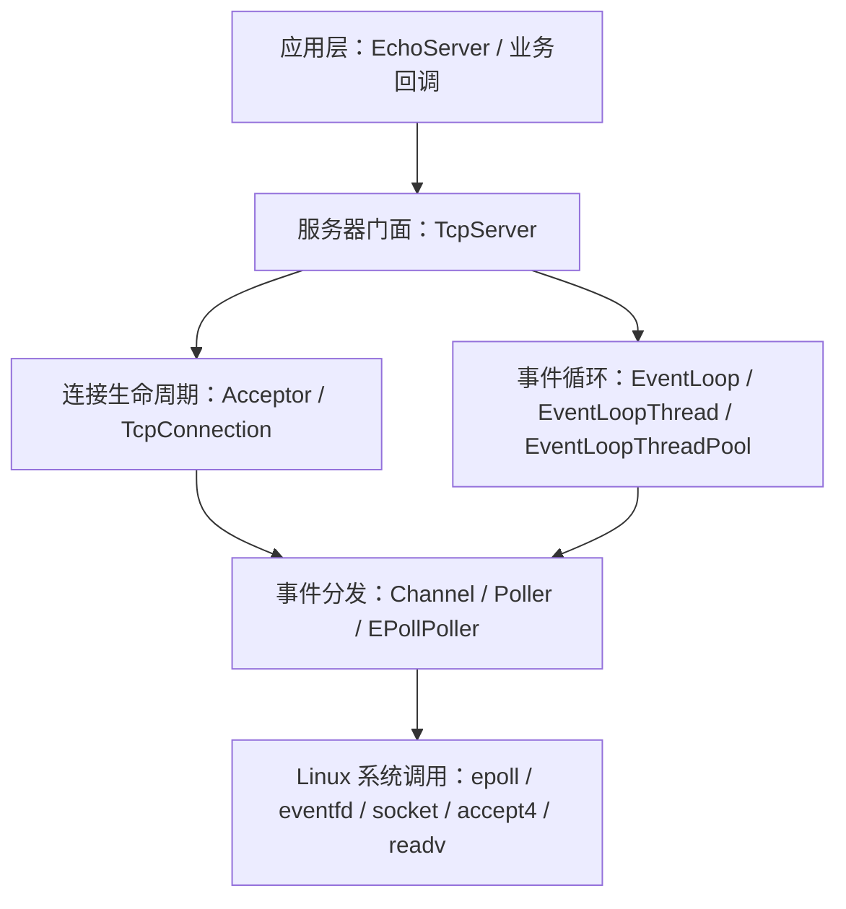
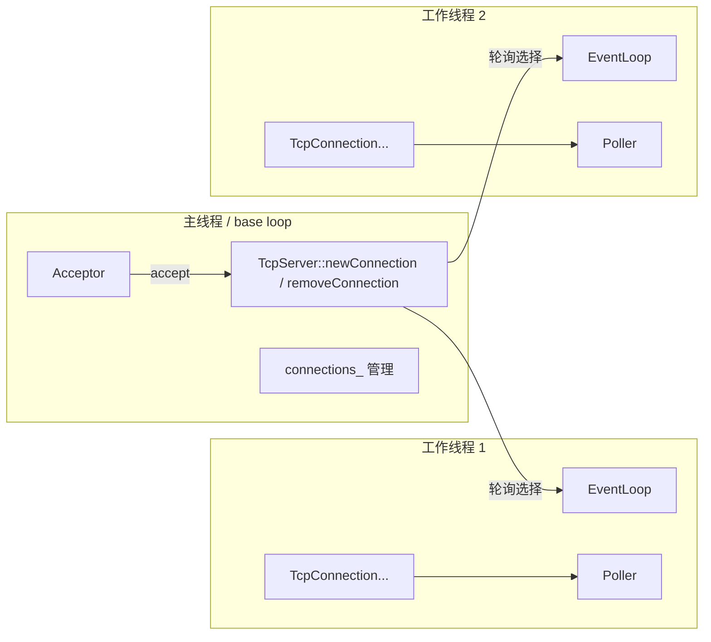
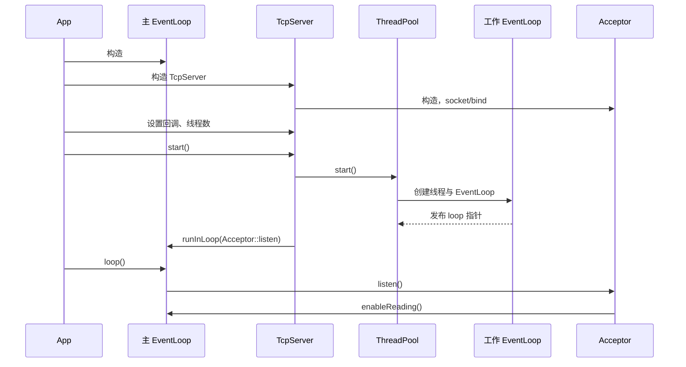
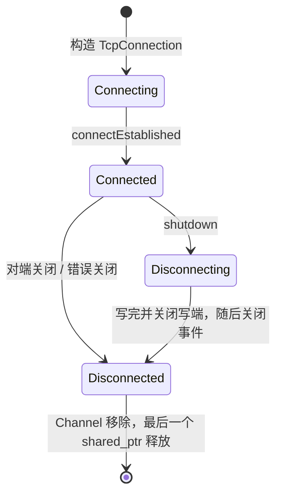
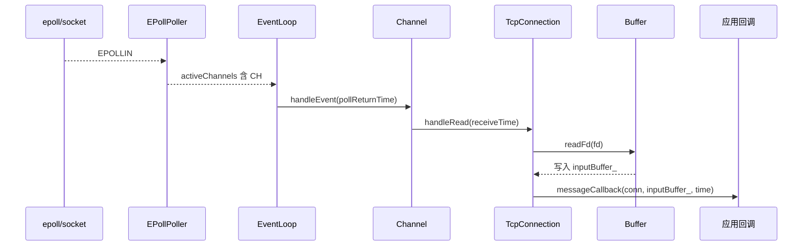
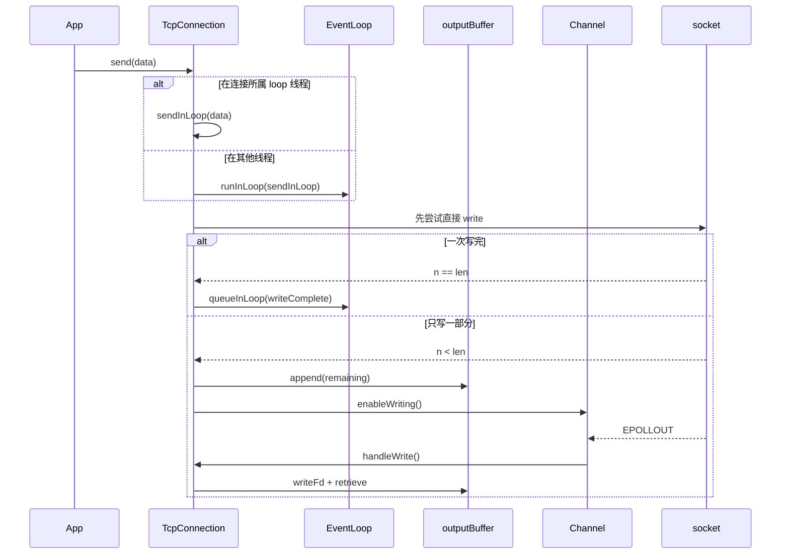

# my_muduo 项目流程与架构复盘

> 分析基线：`fc5783e` 之后的目录重构工作区（2026-10-31）
> 项目性质：仿 muduo 的 Linux C++ TCP 网络库
> 本文范围：当前 `include/`、`src/`、构建配置、Echo 示例与后续现代化方案

## 1. 一句话结论

这是一个以 **Reactor + one loop per thread** 为核心的教学型 TCP 网络库：主事件循环负责监听和接受连接，工作事件循环负责已建立连接上的读写事件；`EventLoop -> Channel -> Poller(epoll)` 构成事件分发主链，`TcpServer -> Acceptor/TcpConnection` 构成服务器对象生命周期主链。

当前代码已经具备一套较为完整的网络库骨架，Echo 示例能够表达主要调用关系。目录重构后，公开头文件、实现文件、示例和文档已经分离，`Channel` 事件位判断和 `Buffer` 初始容量分配问题也已经修复。

当前仍是“可复盘的架构原型”，距离可靠的生产级运行时还有差距，主要风险是：

1. `TcpConnection::send()` 跨线程调用时，异步任务只保存字符串裸指针和 `this`，存在悬空访问。
2. `Timestamp::now()` 把秒数放入“微秒”字段，时间语义不正确。
3. `EventLoop` 已有任务队列，但尚未被整理为具有明确关闭、容量和异常语义的 MPSC TaskQueue。
4. 连接状态机、关闭回调和任务执行顺序缺少完整测试。

下一步的重点不是继续增加回调层，而是明确线程封闭、对象所有权和任务边界。

---

## 2. 项目定位与能力边界

| 维度 | 当前实现 |
|---|---|
| 网络模型 | 非阻塞 TCP、Reactor、level-triggered epoll |
| 并发模型 | 一个事件循环绑定一个线程，主循环 + 工作循环池 |
| 连接分发 | 主循环执行 `accept`，按轮询选择工作循环 |
| 回调模型 | 应用注册连接、消息、写完成回调 |
| 发送缓冲 | 应用发送速度快于内核时进入 `Buffer`，等待 `EPOLLOUT` |
| 协议支持 | 原始字节流；没有拆包、组包或业务协议解析 |
| 客户端支持 | 未实现 `TcpClient`、`Connector`、非阻塞 connect |
| 定时器支持 | 未实现 `TimerQueue`、`TimerId` |
| 信号处理 | 未实现 signal fd 或统一的信号管理 |
| 平台 | Linux；依赖 `epoll`、`eventfd`、`accept4`、`__thread` 等 |
| 交付形式 | CMake 生成 `libmy_muduo.so`，示例通过与库相同的 target 构建 |

它覆盖了 muduo 的服务器端核心路径，但不是 muduo 的完整替代品。复盘时应把“已经跑通的服务器主链”和“尚未实现的 muduo 能力”分开评价。

## 3. 当前文件组织

```text
include/my_muduo/base/   非网络基础设施
include/my_muduo/net/    网络库公开接口，含 Poller 与 EPollPoller
src/base/                base 实现
src/net/                 网络实现
examples/                Echo 示例
docs/                    架构与修复记录
```

公开引用统一使用：

```cpp
#include <my_muduo/net/TcpServer.h>
#include <my_muduo/net/EventLoop.h>
#include <my_muduo/base/Logger.h>
```

`EPollPoller.h` 与 `Poller.h` 一样作为 `net` 公开头文件放在 `include/my_muduo/net`，具体实现位于 `src/net/EPollPoller.cc`。`CurrentThread` 因为被公开的 `EventLoop.h` 直接引用，也放在 `include/my_muduo/base`。

---

## 4. 总体架构

### 4.1 分层视图



### 4.2 核心职责

| 模块 | 主要职责 | 关键源码 |
|---|---|---|
| `TcpServer` | 对外门面；保存连接；装配回调；连接分发与移除 | `include/my_muduo/net/TcpServer.h`、`src/net/TcpServer.cc` |
| `Acceptor` | 持有监听 socket；处理 `EPOLLIN`；调用 `accept4` | `include/my_muduo/net/Acceptor.h`、`src/net/Acceptor.cc` |
| `TcpConnection` | 管理一条 TCP 连接的状态、读写、关闭和回调 | `include/my_muduo/net/TcpConnection.h`、`src/net/TcpConnection.cc` |
| `EventLoop` | 事件循环；epoll 等待；执行活跃 Channel；跨线程任务队列 | `include/my_muduo/net/EventLoop.h`、`src/net/EventLoop.cc` |
| `Channel` | 把 fd、感兴趣事件、返回事件和回调绑定在一起 | `include/my_muduo/net/Channel.h`、`src/net/Channel.cc` |
| `Poller` | 屏蔽 I/O 多路复用实现 | `include/my_muduo/net/Poller.h`、`src/net/Poller.cc` |
| `EPollPoller` | 用 epoll 实现 `poll/update/remove` | `include/my_muduo/net/EPollPoller.h`、`src/net/EPollPoller.cc` |
| `EventLoopThread` | 在独立线程中创建并运行一个 `EventLoop` | `include/my_muduo/net/EventLoopThread.h`、`src/net/EventLoopThread.cc` |
| `EventLoopThreadPool` | 管理工作循环；按轮询分配新连接 | `include/my_muduo/net/EventLoopThreadPool.h`、`src/net/EventLoopThreadPool.cc` |
| `Socket` | 文件描述符 RAII 与 socket 选项 | `include/my_muduo/net/Socket.h`、`src/net/Socket.cc` |
| `Buffer` | 输入/输出缓冲；`readv` 读取；部分写处理 | `include/my_muduo/net/Buffer.h`、`src/net/Buffer.cc` |
| `InetAddress` | 封装 `sockaddr_in`，负责 IP/端口转换 | `include/my_muduo/net/InetAddress.h`、`src/net/InetAddress.cc` |
| `Thread` | `std::thread` 薄封装；等待新线程 tid 就绪 | `include/my_muduo/base/Thread.h`、`src/base/Thread.cc` |
| `Logger` | 控制台日志宏与单例 | `include/my_muduo/base/Logger.h`、`src/base/Logger.cc` |
| `Timestamp` | 时间点表示和格式化 | `include/my_muduo/base/Timestamp.h`、`src/base/Timestamp.cc` |

### 4.3 依赖方向

正常调用方向如下：

```text
应用代码
  -> TcpServer
     -> Acceptor -> Socket / Channel
     -> EventLoopThreadPool -> EventLoopThread -> Thread
     -> TcpConnection -> Socket / Channel / Buffer
        -> EventLoop -> Poller -> EPollPoller -> epoll
                       -> Channel -> 应用回调
```

`Channel` 是“事件”与“对象行为”之间的桥：

```text
fd 上的事件
  -> EPollPoller 返回 Channel*
  -> EventLoop 调用 Channel::handleEvent()
  -> Channel 根据 revents_ 调用 read/write/close/error 回调
  -> 回调进入 Acceptor 或 TcpConnection
```

---

## 5. 对象所有权与生命周期

理解该库时，应先分清“谁拥有对象”和“谁使用裸指针”。

| 拥有者 | 拥有的对象 | 说明 |
|---|---|---|
| `TcpServer` | `unique_ptr<Acceptor>` | 服务器销毁时释放监听器 |
| `TcpServer` | `shared_ptr<EventLoopThreadPool>` | 工作循环池 |
| `TcpServer` | `unordered_map<string, TcpConnectionPtr>` | 作为已建立连接的长期所有者之一 |
| `EventLoopThreadPool` | `vector<unique_ptr<EventLoopThread>>` | 工作线程所有者 |
| `EventLoopThread` | `Thread` | 工作线程包装对象 |
| `EventLoopThread` 的线程函数 | 栈上的 `EventLoop` | `EventLoop` 生命周期与该线程函数一致 |
| `EventLoop` | `unique_ptr<Poller>` | epoll 实例 |
| `EventLoop` | `unique_ptr<Channel> wakeupChannel_` | eventfd 唤醒通道 |
| `Acceptor` | `Socket`、`Channel` 成员对象 | 监听 fd 及其事件通道 |
| `TcpConnection` | `unique_ptr<Socket>`、`unique_ptr<Channel>` | 连接 fd 及其事件通道 |
| `TcpConnection` | `inputBuffer_`、`outputBuffer_` | 输入和输出缓冲 |

非拥有关系：

| 持有者 | 非拥有对象 | 原因 |
|---|---|---|
| `Channel` | `EventLoop*` | Channel 借 loop 注册和更新事件 |
| `Poller` | `Channel*` | Poller 不拥有 Channel，只记录 fd 到 Channel 的映射 |
| `EventLoopThreadPool` | `EventLoop*` | 真正对象在线程栈上 |
| `TcpServer` | `EventLoop* baseLoop_` | 用户负责主循环生命周期 |

### 5.1 `shared_ptr` 与 `weak_ptr` 的作用

`TcpConnection` 继承 `enable_shared_from_this`，通过 `TcpConnectionPtr` 延长生命周期。连接建立时调用：

```cpp
channel_->tie(shared_from_this());
```

`Channel::tie()` 内部保存的是 `weak_ptr<void>`。处理事件前先 `lock()`：

- 如果连接对象仍然存在，取得临时强引用并执行回调。
- 如果连接对象已经销毁，不再访问悬空回调。

这解决的是“Channel 回调开始执行时，TcpConnection 是否还活着”的问题，而不是所有线程安全问题。

### 5.2 连接的释放链

正常关闭时，`TcpServer::connections_` 与本次回调中的临时 `shared_ptr` 共同影响连接对象的生命周期：

1. `TcpConnection::handleClose()` 取得 `shared_ptr` 并触发用户断开回调。
2. `TcpServer::removeConnection()` 把移除任务投递回主 loop。
3. 主 loop 中执行 `connections_.erase()`，服务器不再持有该连接。
4. 连接所在的工作 loop 执行 `connectDestroyed()`，从 Poller 中移除 Channel。
5. 最后一个 `shared_ptr` 释放后，`TcpConnection` 析构，随后 `Channel`、`Socket` 析构并关闭 fd。

因此回调期间不能简单地“断开后立即删除连接”，否则容易在回调返回前释放正在执行的对象。

---

## 6. 线程模型

### 6.1 主循环与工作循环



关键规则：

1. 一个线程最多创建一个 `EventLoop`，由线程局部变量 `t_loopInThisThread` 检查。
2. 一个 `TcpConnection` 只属于一个工作 loop，它的 Channel 只应在这条 loop 所在线程修改。
3. `Acceptor` 和 `connections_` 的管理运行在主 loop。
4. 新连接的 `connectEstablished()` 被投递到工作 loop，而不是在主 loop 直接执行。
5. 跨线程操作应使用 `EventLoop::runInLoop()` 或 `EventLoop::queueInLoop()`。

当 `setThreadNum(0)` 时，线程池不创建新线程，新连接回退到主 loop 管理。

### 6.2 `runInLoop` 与 `queueInLoop`

`EventLoop::runInLoop(cb)`：

- 当前线程就是 loop 所属线程：立即执行。
- 当前线程不是 loop 所属线程：放入 `pendingFunctors_`，必要时唤醒 loop 线程。

`EventLoop::queueInLoop(cb)`：

- 总是放入任务队列。
- 如果调用者在其他线程，或当前 loop 正在执行任务队列，则向 eventfd 写入数据。

eventfd 被包装成一个普通 `Channel`。loop 阻塞在 `epoll_wait()` 时，向 eventfd 写入一个 `uint64_t` 会让 `wakeupChannel_` 可读，从而唤醒目标线程。

### 6.3 为什么需要 eventfd

只把任务放进 `pendingFunctors_` 不够：目标 loop 可能正阻塞在 `epoll_wait()`，没有 fd 事件就不会返回。eventfd 的作用是制造一个明确的“有新任务”事件，让目标线程尽快退出等待并执行任务队列。

---

## 7. 启动流程

以 `examples/echo_server.cpp` 为例：

```cpp
int main() {
    EventLoop loop;
    InetAddress addr(8000);
    EchoServer server(&loop, addr, "EchoServer_01");
    server.start();
    loop.loop();
}
```

### 7.1 构造主 `EventLoop`

`EventLoop` 构造时依次完成：

1. 调用 `Poller::newDefaultPoller(this)` 创建默认 Poller。
2. 当前实现实际创建 `EPollPoller`。
3. 调用 `eventfd()` 创建唤醒 fd。
4. 创建 `wakeupChannel_` 并注册读回调。
5. `enableReading()` 把唤醒 fd 注册进 epoll。
6. 把当前 `EventLoop*` 记录到线程局部变量，防止同一线程重复创建 loop。

此时 epoll 已在工作，但主 `EventLoop::loop()` 还没有开始。

### 7.2 构造 `InetAddress`

示例构造 `127.0.0.1:8000`。当前实现只支持 IPv4，内部保存标准化前的 IPv4 地址和网络字节序端口。

### 7.3 构造 `EchoServer` / `TcpServer`

`TcpServer` 构造过程：

1. 保存主 loop、监听地址字符串、服务器名。
2. 创建 `Acceptor`。
3. 创建 `EventLoopThreadPool`。
4. 把 `TcpServer::newConnection` 注册为 Acceptor 的新连接回调。

`Acceptor` 构造过程：

1. 用 `SOCK_NONBLOCK | SOCK_CLOEXEC` 创建监听 socket。
2. 设置 `SO_REUSEADDR`。
3. 根据选项设置 `SO_REUSEPORT`。
4. `bind()` 到监听地址。
5. 创建监听 fd 对应的 `Channel`。
6. 绑定 `Acceptor::handleRead` 作为 Channel 的读回调。

### 7.4 配置回调与线程数

示例设置：

```cpp
server_.setConnectionCallback(...);
server_.setMessageCallback(...);
server_.setThreadNum(3);
```

`setThreadNum()` 应在 `start()` 之前调用。当前代码没有检查“已经启动后再修改线程数”的情况。

### 7.5 调用 `TcpServer::start()`

`start()` 只在第一次调用时执行有效初始化：

1. 启动工作线程池。
2. 每个 `EventLoopThread` 创建线程。
3. 工作线程中构造自己的 `EventLoop`。
4. 工作线程通过条件变量把 `EventLoop*` 发布给 `startLoop()` 的调用者。
5. 主 loop 收到 `Acceptor::listen()` 任务。
6. 主 loop 开始 `loop.loop()` 后执行该任务，调用 `listen()` 并注册监听 fd 的读事件。



---

## 8. 新连接流程

监听 fd 可读后，主 loop 的事件链如下：

```text
EPollPoller::poll()
  -> activeChannels 包含 acceptChannel_
  -> Channel::handleEvent()
  -> Acceptor::handleRead()
  -> Socket::accept()
  -> TcpServer::newConnection()
```

### 8.1 `Acceptor::handleRead()`

1. 调用 `accept4()` 获得非阻塞子 socket。
2. 同时取得客户端地址。
3. 存在新连接回调时执行 `newConnectionCallback_(connfd, peerAddr)`。
4. 没有回调时直接关闭该 fd。
5. `EMFILE` 只记录日志，没有 idle fd 隔离救援机制。

### 8.2 `TcpServer::newConnection()`

主 loop 中执行：

1. `getNextLoop()` 轮询选择一个工作 loop。
2. 生成连接名：`服务器名-监听地址#连接序号`。
3. 用 `getsockname()` 取得连接的本端地址。
4. 创建 `TcpConnection` 并保存到 `connections_`。
5. 把服务器的连接、消息、写完成回调复制给连接。
6. 把内部 `removeConnection` 设置为连接的关闭回调。
7. 向选定工作 loop 投递 `connectEstablished()`。

### 8.3 `connectEstablished()`

在工作 loop 中执行：

1. 状态从 `kConnecting` 变为 `kConnected`。
2. 用 `tie(shared_from_this())` 建立回调期间的弱生命周期保护。
3. 注册 `EPOLLIN`，开始监听客户端数据。
4. 调用用户的连接回调，通知“连接已建立”。

这里体现了两个重要设计：

- 新连接对象虽然由主 loop 创建，但从注册事件开始，它完全归工作 loop 管理。
- 用户看到“连接 UP”时，连接已经进入正确的 IO 线程，并已完成事件注册。

---

## 9. 一条连接的运行状态机



当前状态值：

- `kDisconnected`
- `kConnecting`
- `kConnected`
- `kDisconnecting`

`state_` 是原子的，但状态转换几乎都发生在连接的 IO loop 中。它不是完整的状态机实现，没有 CAS、序列号或“只允许一次关闭回调”的强约束。

---

## 10. 读数据处理流程



关键步骤：

1. `EPollPoller` 通过 `event.data.ptr` 直接拿回 `Channel*`。
2. 把 epoll 返回的事件写入 `Channel::revents_`。
3. `Channel::handleEvent()` 先通过 `weak_ptr` 检查连接是否还存活。
4. `TcpConnection::handleRead()` 调用 `Buffer::readFd()`。
5. `readFd()` 使用 `readv`，第一块空间写入 Buffer 可写区，第二块写入 64 KiB 栈缓冲，避免“不知道数据总量”导致固定缓冲不够。
6. 读到数据后调用应用消息回调。
7. 应用应自行消费 `inputBuffer_`；示例调用 `retrieveAllAsString()`。

`Buffer` 工作在 level-triggered epoll 下：如果本次没有读完，fd 下次仍会报告可读。

### 10.1 为什么消息回调拿到的是 Buffer

TCP 是字节流，不是消息流。一次 `read` 得到的字节数由内核和网络状态决定，可能对应：

- 半个应用消息；
- 一个应用消息；
- 多个应用消息；
- 多个消息的任意切分。

网络库提供缓冲区和原始字节，业务层必须根据协议做长度字段、分隔符或固定包头解析。当前 Echo 示例直接回显当前缓冲区全部内容，并没有实现消息边界。

---

## 11. 写数据与背压流程

### 11.1 设计上的发送路径



设计目标：

1. 应用可以直接调用 `send()`，线程切换由连接处理。
2. 内核可写时尝试立即发送，降低延迟。
3. 只发送一部分时，把剩余数据放进 `outputBuffer_`。
4. 注册 `EPOLLOUT`，等待内核再次可写。
5. 积压达到水位时通知应用限制生产速度。
6. 全部写完后取消 `EPOLLOUT`，触发写完成回调。

### 11.2 已修复的事件位判断

`Channel::isWriting()` 和 `isReading()` 已经改为位集合判断：

```cpp
bool isWriting() const { return (events_ & kWriteEvent) != 0; }
bool isReading() const { return (events_ & kReadEvent) != 0; }
```

连接默认开启读事件。等待 `EPOLLOUT` 时，`events_` 通常同时包含读事件与写事件，因此不能用整体相等判断。修复后：

- `handleWrite()` 能在读写事件并存时刷新输出缓冲。
- `shutdownInLoop()` 能通过写事件位判断是否还有待完成写入。
- level-triggered epoll 不会因为错误忽略写事件而持续空转。

详细复盘见 `docs/fixes/channel-event-mask.md`。

### 11.3 跨线程发送的悬空指针

当前跨线程路径：

```cpp
loop_->runInLoop(
    std::bind(&TcpConnection::sendInLoop, this, buf.data(), buf.size()));
```

`std::bind` 保存的是 `buf.data()` 得到的裸指针，并未复制字符串。若调用方传入临时对象，或局部字符串在任务执行前离开作用域，工作线程后续使用该指针就是悬空访问。

更安全的思路是让异步任务拥有数据，例如捕获 `std::string data(buf)`，再把 `data.data()` 传给实际写入函数；或者把发送接口改造成 Buffer/字符串值语义。

---

## 12. 关闭流程

### 12.1 主动优雅关闭

应用调用 `TcpConnection::shutdown()`：

1. 若处于 `kConnected`，状态先变为 `kDisconnecting`。
2. 在连接所属 loop 中执行 `shutdownInLoop()`。
3. 如果没有待发送数据，调用 `shutdown(fd, SHUT_WR)` 关闭写端。
4. 对端收到 EOF 后关闭；本端随后通过读事件观察 EOF 或 HUP，完成连接销毁。

`isWriting()` 已修复；当前更需要注意的是关闭状态机、输出缓冲清空和回调顺序尚未被完整测试。

### 12.2 对端关闭

`TcpConnection::handleRead()` 中：

- `readv` 返回 `0`：对端关闭，调用 `handleClose()`。
- `readv` 返回负值：记录 errno 并调用错误处理。
- `readv` 返回正值：交给应用消息回调。

`handleClose()` 会：

1. 状态设为 `kDisconnected`。
2. 禁用 Channel 的全部事件。
3. 调用用户的连接回调，报告 DOWN。
4. 调用内部关闭回调，进入 `TcpServer::removeConnection()`。

### 12.3 `EPOLLHUP` 与 `EPOLLERR`

`Channel` 对事件采用独立 `if` 判断，并非 `if/else if`：

- `EPOLLHUP` 且没有 `EPOLLIN`：调用关闭回调。
- `EPOLLERR`：调用错误回调。
- `EPOLLIN/EPOLLPRI`：调用读回调。
- `EPOLLOUT`：调用写回调。

同一轮事件可能同时触发多个分支。当前 `TcpConnection::handleError()` 只记录 `SO_ERROR`，不直接关闭连接；实际关闭通常依赖后续 EOF/HUP。

---

## 13. EventLoop 一轮循环

`EventLoop::loop()` 的主体是：

```cpp
while (!quit_) {
    activeChannels_.clear();
    pollReturnTime_ = poller_->poll(10s, &activeChannels_);

    for (Channel* channel : activeChannels_) {
        channel->handleEvent(pollReturnTime_);
    }

    doPendingFunctors();
}
```

一轮循环包括：

1. 清空上一轮活跃 Channel。
2. 在 epoll 中最多等待 10 秒。
3. Poller 把本轮就绪的 Channel 写入 `activeChannels_`。
4. 逐个调用 Channel 回调。
5. 执行跨线程投递到本 loop 的任务。

设计特点：

- 普通 FD 事件优先处理，pending functors 在事件后执行。
- `quit()` 可从其他线程调用，并通过 eventfd 唤醒 loop。
- 当前固定 10 秒超时没有定时器语义，只是限制永久阻塞。

当前代码没有在 `loop()` 开头断言“调用者就是 EventLoop 所属线程”。用户若不慎在其他线程调用 `loop()`，事件回调虽然仍可运行，但 `threadId_` 和实际执行线程会不一致，后续线程判断会失真。

---

## 14. Channel、Poller 与 epoll

### 14.1 Channel 的三类状态

| 字段 | 含义 |
|---|---|
| `events_` | 本端希望监听的事件 |
| `revents_` | epoll 本轮实际返回的事件 |
| `index_` | Channel 在 Poller 中的登记状态 |

`index_` 使用三个值：

- `kNew = -1`：尚未加入 Poller。
- `kAdded = 1`：已经加入 Poller。
- `kDeleted = 2`：曾经加入，事件变为空后从 epoll 删除。

### 14.2 Poller 更新规则

`EPollPoller::updateChannel()`：

- `kNew`：建立 fd 到 Channel 的映射，并执行 `EPOLL_CTL_ADD`。
- `kDeleted`：执行 `EPOLL_CTL_ADD`，恢复登记。
- 已登记且没有任何感兴趣事件：执行 `EPOLL_CTL_DEL`，标记 `kDeleted`。
- 已登记且仍有事件：执行 `EPOLL_CTL_MOD`。

`removeChannel()`：

1. 从 `channels_` 映射中删除 fd。
2. 若当前仍登记在 epoll，则执行 `EPOLL_CTL_DEL`。
3. 把 Channel 的 index 恢复为 `kNew`。

### 14.3 `event.data.ptr`

向 epoll 注册事件时，使用：

```cpp
event.data.ptr = channel;
```

`epoll_wait()` 返回后可以直接从 `data.ptr` 取回 Channel，不需要再按 fd 查表。这减少了事件路径上的一次哈希查找，但也意味着 Channel 的生命周期必须覆盖 epoll 返回和回调处理窗口。

### 14.4 level-triggered 模式

当前注册的是普通 `EPOLLIN/EPOLLOUT/EPOLLPRI`，没有 `EPOLLET`，因此采用 level-triggered：

- 只要 fd 仍可读，下一轮 epoll 仍会继续报告。
- 本次没读完不会永久丢失通知。
- 与 `Buffer::readFd()` 的扩容和后续继续读取方式相容。

---

## 15. Buffer 设计

### 15.1 三段式布局

```text
| prependable | readable | writable |
0             R          W          end
```

- `readerIndex_`：应用下一次读取位置。
- `writerIndex_`：下一次写入位置。
- `readableBytes()`：`W - R`。
- `writableBytes()`：`end - W`。
- `prependableBytes()`：`R`。

### 15.2 读取

`readFd()` 使用两个 `iovec`：

1. 第一块指向 Buffer 当前可写区域。
2. 第二块指向 64 KiB 栈上临时区。

这样一次 `readv` 可以读取“Buffer 剩余空间 + 64 KiB”，避免因 Buffer 较小而多一次系统调用。超出 Buffer 的部分随后追加进 Buffer。

### 15.3 扩容与搬移

`makeSpace()` 有两种选择：

- 已有预留区和可写区总和足够：把剩余可读数据搬到前面，扩展可写区域。
- 空间确实不足：调整 `vector` 大小。

### 15.4 已修复的初始容量

构造函数已经正确分配预留区与初始可写区：

```cpp
explicit Buffer(size_t initialSize = kInitialSize)
    : buffer_(kCheapPrepend + initialSize)
    , readerIndex_(kCheapPrepend)
    , writerIndex_(kCheapPrepend)
{}
```

默认 Buffer 的底层容量为 `8 + 1024` 字节，可写区为 1024 字节；自定义 `initialSize` 也会生效。

---

## 16. Echo 示例完整复盘

示例注册两个关键回调：

```cpp
server_.setConnectionCallback(...onConnection...);
server_.setMessageCallback(...onMessage...);
server_.setThreadNum(3);
```

### 16.1 连接建立

`onConnection()` 通过 `conn->connected()` 判断：

- 连接已建立：打印客户端地址。
- 连接断开：打印断开日志。

该回调实际可能由不同的工作 loop 并发调用，因此应用层必须自行处理共享状态。

### 16.2 收到消息

```cpp
void onMessage(const TcpConnectionPtr& conn, Buffer* buf, Timestamp time) {
    std::string msg = buf->retrieveAllAsString();
    conn->send(msg);
    conn->shutdown();
}
```

处理顺序是：

1. 把当前输入缓冲全部转成字符串。
2. 原样发送回去。
3. 关闭连接写端。

它演示了 API，但不是一个真正的长连接 Echo 协议：服务端每收到一批字节就关闭写端，下一次客户端交互需要重新建立连接。

如果 `send()` 立即把数据全部写入内核，示例通常能表现正常。若发生部分写，现有输出缓冲和 `EPOLLOUT` 路径已经能够继续刷新，但跨线程发送仍然存在数据生命周期问题。

---

## 17. 构建、安装与运行

项目只能在支持 Linux socket/epoll 的环境运行。当前源码不能直接在原生 Windows 上编译，因为缺少 `sys/epoll.h`、`sys/eventfd.h`、`accept4()` 等接口。

### 17.1 自动构建

```bash
./autobuild.sh
```

脚本执行：

1. `cmake -S . -B build -DCMAKE_BUILD_TYPE=Release`
2. `cmake --build build --parallel`
3. 把公开头文件安装到 `/usr/local/include/my_muduo`
4. 把动态库安装到 `/usr/local/lib`
5. 执行 `ldconfig`

脚本使用 `sudo`，所以会请求系统权限。

### 17.2 直接构建

```bash
cmake -S . -B build -DCMAKE_BUILD_TYPE=Debug
cmake --build build --parallel
```

示例通过库 target 自动获得 `<my_muduo/...>` 包含路径，不需要预先安装到系统目录。示例程序位于 `build/examples/echo_server`。

### 17.3 基础验证

```bash
./build/examples/echo_server
printf 'hello\n' | nc 127.0.0.1 8000
```

本文对当前检查环境只做了源码静态核验；当前 Windows 环境没有可用的 WSL/Linux 编译链，因此没有在本机执行运行测试。涉及运行时行为的结论均来自源码调用链，而不是压测结果。

---

## 18. 当前实现与 muduo 经典结构的对应关系

| 能力 | 当前项目 | muduo 经典路径中的对应物 |
|---|---|---|
| 事件循环 | `EventLoop` | `EventLoop` |
| 事件抽象 | `Channel` | `Channel` |
| I/O 复用抽象 | `Poller` / `EPollPoller` | `Poller` / `EPollPoller` |
| loop 唤醒 | eventfd + `wakeupChannel_` | eventfd + `wakeupChannel_` |
| 服务器 | `TcpServer` | `TcpServer` |
| 监听器 | `Acceptor` | `Acceptor` |
| 连接 | `TcpConnection` | `TcpConnection` |
| 工作线程池 | `EventLoopThreadPool` | `EventLoopThreadPool` |
| 缓冲 | `Buffer` | `Buffer` |
| 日志/时间 | `Logger` / `Timestamp` | 更完整的 Logger、Timestamp |

尚未覆盖的典型能力：

- Poller 的 `poll(2)` 实现与运行时切换。当前环境变量分支会返回空指针，不能实际使用。
- `TimerQueue`、`TimerId`、`runAt/runAfter/runEvery`。
- `TcpClient`、`Connector`、非阻塞 connect。
- `TcpServer` 的连接 ID 更完整管理、accept 错误救援。
- `EventLoop::assertInLoopThread()` 等线程契约检查。
- 更完整的 TCP 选项、回调异常保护、日志线程安全与文件输出。
- `ProtobufCodec`、长度前缀、包头解析等协议层。
- 测试、压测、信号处理和优雅停机。

---

## 19. 架构风险清单

### 19.1 高风险

| 风险 | 证据 | 影响 | 建议 |
|---|---|---|---|
| 跨线程 send 生命周期错误 | `src/net/TcpConnection.cc:43-49` | 异步任务可能访问已销毁字符串或连接对象，出现崩溃或数据损坏 | 任务拥有数据副本，并用 `TcpConnectionPtr` 或等价机制保护连接 |
| Timestamp 单位错误 | `src/base/Timestamp.cc:13-19` | `now()` 返回秒却按微秒解释，日志时间严重错误 | 使用 `gettimeofday()`/`system_clock`，明确统一微秒 |
| 关闭状态与回调顺序不完整 | `src/net/TcpConnection.cc:101-180` | 主动关闭、对端关闭、错误关闭可能走不同路径，缺少“回调只触发一次”的保证 | 建立显式状态机，统一关闭入口和最终析构路径 |
| EventLoop 任务缺少关闭与容量语义 | `src/net/EventLoop.cc:96-153` | 停机时任务可能未执行；跨线程命令可无限积压；异常会中断 loop | 抽出 MPSC TaskQueue，明确拒绝、取消、排空和异常策略 |

### 19.2 中风险

| 风险 | 证据 | 影响 | 建议 |
|---|---|---|---|
| Logger 存在数据竞争 | `src/base/Logger.cc:11-36` | 多 IO 线程同时输出时级别和文本可能错乱 | 每次调用独立级别；加锁或线程本地格式化 |
| `LOG_FATAL` 直接 `exit(-1)` | `include/my_muduo/base/Logger.h:29-38` | 库内错误会终止整个进程，无法统一补偿 | 区分可恢复错误与不可恢复错误，提供终止策略 |
| `MUDUO_USE_POLL` 返回空 Poller | `src/net/DefaultPoller.cc:7-10` | 设置该环境变量后 EventLoop 可能空指针崩溃 | 未实现 poll 前明确报错，或补齐 PollPoller |
| loop 缺少线程断言 | `src/net/EventLoop.cc:50-75` | 在错误线程运行 loop 时难以发现契约破坏 | 增加 `assertInLoopThread()` |
| 错误事件只记录日志 | `src/net/TcpConnection.cc:183-193` | 某些错误可能留下未关闭连接 | 统一 `handleError()` 为关闭或状态转换 |
| 无空闲 fd 救援 | `src/net/Acceptor.cc:42-56` | `EMFILE` 后新连接持续失败 | 预开 idle fd，必要时释放并 accept，再关闭 |
| 没有应用层拆包机制 | `examples/echo_server.cpp:35-38` | 长连接业务可能出现粘包/半包 | 增加长度字段编解码或独立 parser/Codec |

### 19.3 低风险与工程化问题

| 风险 | 证据 | 影响 |
|---|---|---|
| `TcpConnection::send` 只支持 `std::string` | `include/my_muduo/net/TcpConnection.h:36` | 二进制数据和所有权明确的发送接口受限 |
| `Thread::numCreated_` 计数不准确 | `src/base/Thread.cc:8-15,45-51` | 构造时增加两次，析构只减少一次；默认线程名不符合预期 |
| `InetAddress` 仅支持 IPv4 | `include/my_muduo/net/InetAddress.h:11-20` | 不支持 IPv6；`inet_addr()` 错误也未检查 |
| `TcpNoDelay` 已封装但未启用 | `src/net/Socket.cc:45-48` | 小包延迟可能偏高；是否启用应作为策略 |
| CMake 未导出 package config | `CMakeLists.txt:67-72` | 下游可安装文件，但暂时不能通过 `find_package(my_muduo)` 使用 target |
| 连接析构阶段缺少集中停机协议 | `src/net/TcpServer.cc:28-38` | 待执行任务与 loop 退出顺序较脆弱，缺少测试保障 |
| 没有自动化测试 | `tests/` 尚未建立 | 部分写、关闭、跨线程任务和停机流程无法持续回归 |

---

## 20. 建议的复盘顺序

如果目的是通过项目学习 muduo，建议按以下顺序回看，而不是从宏和工具类开始：

1. **先画事件环**：`EventLoop::loop()` 如何拿事件、分发事件、执行 pending functors。
2. **再画 fd 到对象**：`EPollPoller::updateChannel()` 如何维护 `fd -> Channel*`。
3. **再画连接生命周期**：`TCPConnection` 何时创建、在哪个线程建立、何时被移出 map。
4. **再画跨线程路径**：主 loop 如何选工作 loop，如何通过 eventfd 把任务交给目标线程。
5. **最后看读写缓冲**：部分读、部分写、EOF、错误、关闭分别发生什么。

每个阶段都回答四个问题：

- 这个对象归谁所有？
- 这个函数应在哪个线程执行？
- 这个回调持有什么生命周期保证？
- 事件未被一次处理完时，下一次如何继续？

---

## 21. 目标架构：Executor + MPSC TaskQueue

下一阶段保留现有 one-loop-per-thread 模型，不引入全局 MPMC 工作池。目标是让对象自己处理状态，通过所属 EventLoop 串行执行命令，减少上层反复注入内部回调。

```text
应用层
  -> TcpServer 的应用回调 / ConnectionHandler
       |
       v
TcpConnection 对外方法
  -> 捕获数据与 self
  -> EventLoop::post()
       |
       v
每线程 MPSC TaskQueue
       |
       v
TcpConnection::sendInLoop / closeInLoop
       |
       v
Channel
  -> ChannelHandler 固定接口
       |
       v
Poller -> epoll
```

### 21.1 两类回调要分开

内部固定关系不应继续依赖任意可替换的 `std::function`：

```cpp
class ChannelHandler {
public:
    virtual ~ChannelHandler() = default;
    virtual void handleRead(Timestamp receiveTime) = 0;
    virtual void handleWrite() = 0;
    virtual void handleClose() = 0;
    virtual void handleError() = 0;
};
```

`TcpConnection` 拥有 `Channel` 并实现 `ChannelHandler`。Channel 只保存父对象引用，不拥有父对象，也不长期保存强引用 lambda。

`Acceptor` 同理可以使用内部 `AcceptorHandler`，由 `TcpServer` 实现。连接关闭后的注销可以由内部 `ConnectionOwner` 接口或连接管理器负责。

应用层仍然保留可定制回调或 `ConnectionHandler`，因为业务逻辑必须由库使用者提供。目标是减少内部回调，而不是取消所有扩展点。

### 21.2 TaskQueue 的边界

队列放在 EventLoop/Executor 层，每线程一个，不放在每个 Channel、Acceptor 或 TcpConnection 中。

建议语义：

```cpp
class Executor {
public:
    virtual ~Executor() = default;

    virtual void post(Task task) = 0;      // 总是异步
    virtual void execute(Task task) = 0;   // 当前执行器线程则立即执行
    virtual bool inExecutorThread() const noexcept = 0;
};
```

TaskQueue 需要明确：

1. 多个生产者入队，一个 EventLoop 线程消费。
2. 使用 mutex 保护队列，消费时通过 `swap` 批量取出，减少锁占用。
3. 使用 eventfd 唤醒 epoll；可以合并重复唤醒。
4. 单个任务异常不能终止 loop。
5. `stop()` 后拒绝新任务。
6. 停机时明确选择“排空”还是“取消”，不能依赖容器析构的偶然顺序。
7. 为跨线程 send 设置队列上限或背压，避免无限积压。

epoll 返回的 Channel 事件已经在正确的 IO 线程中，应直接处理，不必再次放入 TaskQueue。只有其他线程发起的命令才需要 `post()`。

### 21.3 lambda 捕获规则

`std::bind` 改为 lambda 后，捕获内容更明确，但不会自动解决生命周期问题。

一次性跨线程 send 命令应采用：

```cpp
void TcpConnection::send(std::string data) {
    if (state_.load() != kConnected) {
        return;
    }

    auto self = shared_from_this();
    loop_->post([self, data = std::move(data)]() mutable {
        if (self->state_.load() != kConnected) {
            return;
        }
        self->sendInLoop(data.data(), data.size());
    });
}
```

捕获规则：

| 捕获方式 | 生命周期 | 使用位置 |
|---|---|---|
| `[this]` | 不延长对象生命周期 | 已证明对象存活的同步调用 |
| `[&]` | 引用可能立即失效 | 禁止用于异步任务 |
| `[self = shared_from_this()]` | 强拥有 | 一次性跨线程命令 |
| `[weak = weak_from_this()]` | 可失效的安全引用 | 长期保存的回调或观察者 |

不能把 `[self = shared_from_this()]` 长期存进由 TcpConnection 自己拥有的 Channel，否则会形成强引用环。长期子对象关系更适合固定接口和父对象引用。

### 21.4 连接操作全部线程封闭

目标 API 应以命令语义表达线程边界：

```cpp
void send(std::string data);       // 任一线程，post 到 loop
void shutdown();                   // 任一线程，post 到 loop
void forceClose();                 // 任一线程，post 到 loop

void sendInLoop(std::string data); // 仅 loop 线程
void shutdownInLoop();             // 仅 loop 线程
void closeInLoop();                // 仅 loop 线程
```

状态机应统一处理：

1. 连接建立前拒绝发送。
2. 主动关闭先停止接收或等待输出缓冲清空。
3. EOF、HUP、错误和主动关闭最终收敛到同一个 `closeInLoop()`。
4. 用户断开回调最多触发一次。
5. Channel 先移出 Poller，Socket 最后关闭。
6. `TcpServer` 中的连接注销通过所属 loop 的命令完成。

---

## 22. 重构的具体执行

### 阶段 0：建立可回归基线

先建立最小测试，否则任务队列和生命周期重构无法证明没有回归。

测试目录：

```text
tests/
├── test_task_queue.cpp
├── test_channel.cpp
├── test_eventloop.cpp
├── test_tcp_connection.cpp
└── test_echo_integration.cpp
```

重点覆盖：

- 同一线程与跨线程 `post()`。
- eventfd 唤醒和 loop 退出。
- Channel 读写事件位组合。
- 临时字符串跨线程发送。
- 目标连接在任务执行前关闭。
- 部分写、输出缓冲清空和优雅关闭。
- 对端 EOF、RST 和主动关闭。
- 多个生产者并发提交任务。
- 停机时拒绝、排空或取消任务。

验收标准：ASan 无悬空访问，TSan 无数据竞争，测试能稳定重复运行。

### 阶段 1：抽取 TaskQueue

计划新增：

```text
include/my_muduo/base/TaskQueue.h
src/base/TaskQueue.cpp
```

修改 `EventLoop`：

1. 保留 `queueInLoop()` 作为兼容入口。
2. 内部把 `pendingFunctors_ + mutex_` 迁移到 TaskQueue。
3. `wakeupFd_` 仍由 EventLoop 管理，通过 notifier 回调连接队列。
4. 增加 `assertInLoopThread()`。
5. 增加明确的 `stop()` 和任务释放策略。
6. 捕获并隔离单任务异常。

这一阶段不改变 TcpConnection 的逻辑，只替换任务存储和唤醒实现，便于独立验证。

### 阶段 2：修正跨线程发送

修改：

```text
include/my_muduo/net/TcpConnection.h
src/net/TcpConnection.cc
```

执行步骤：

1. 将公开的 `send(const std::string&)` 改为拥有数据的值语义接口，或提供 `send(Buffer&&)`。
2. 跨线程时捕获 `shared_ptr<TcpConnection>` 和数据值。
3. 任务执行时再次检查连接状态。
4. `sendInLoop()` 负责直接写、剩余数据入 `outputBuffer_`、注册 `EPOLLOUT`。
5. 写完成回调通过所属 loop 投递。
6. 增加输出队列上限和背压结果，避免无界增长。

验收标准：强制部分写、多线程发送和关闭竞争下数据不丢失、不越界。

### 阶段 3：统一连接状态机

在 TcpConnection 内明确状态转换函数：

```text
Connecting
  -> Connected
  -> Disconnecting
  -> Closed
```

所有关闭原因进入同一个内部入口，例如：

```cpp
void TcpConnection::closeInLoop(CloseReason reason);
```

步骤：

1. 清理重复的 close 分支。
2. Channel 禁用事件并从 Poller 移除。
3. 取消未执行连接命令或让其安全失败。
4. 输出缓冲按策略丢弃或等待截止时间。
5. 用户断开回调只执行一次。
6. 通知 TcpServer 从连接集合移除。
7. 最后释放 Socket 和 Channel。

### 阶段 4：固定内部处理器接口

计划新增：

```text
include/my_muduo/net/ChannelHandler.h
include/my_muduo/net/AcceptorHandler.h
```

修改：

```text
include/my_muduo/net/Channel.h
src/net/Channel.cc
include/my_muduo/net/Acceptor.h
src/net/Acceptor.cc
include/my_muduo/net/TcpConnection.h
src/net/TcpConnection.cc
include/my_muduo/net/TcpServer.h
src/net/TcpServer.cc
```

执行顺序：

1. Channel 改为接收稳定的 `ChannelHandler&`。
2. TcpConnection 实现 ChannelHandler。
3. 删除 Channel 中四个可替换内部回调。
4. Acceptor 改为接收 `AcceptorHandler&`。
5. TcpServer 实现 AcceptorHandler 和 ConnectionOwner。
6. 应用层 callback 保持独立，不向网络组件泄漏业务类型。

处理器引用成立的前提是所有权固定：

```text
TcpServer 拥有 Acceptor
TcpConnection 拥有 Channel
父对象一定晚于子对象销毁
销毁前先取消 Poller 中的登记
```

### 阶段 5：整理应用层接口

内部回调清理完成后再整理应用回调，避免同时改动过多层次。

可选方案：

```cpp
class ConnectionHandler {
public:
    virtual ~ConnectionHandler() = default;
    virtual void onConnected(const TcpConnectionPtr&) = 0;
    virtual void onMessage(const TcpConnectionPtr&, Buffer&) = 0;
    virtual void onClosed(const TcpConnectionPtr&, CloseReason) = 0;
    virtual void onError(const TcpConnectionPtr&, const Error&) = 0;
};
```

要求：

1. start 后不再修改 handler。
2. handler 由 `shared_ptr` 或明确的服务器所有者管理。
3. `onMessage` 中的 Buffer 只在回调期间有效。
4. 慢业务移到独立逻辑队列，不阻塞 IO loop。
5. 回调异常由服务器边界捕获，不能逃逸到 EventLoop。

### 阶段 6：补齐协议、定时器和工程化

1. 增加长度前缀或分隔符 parser/Codec。
2. 增加 TimerQueue 和 timerfd 定时器。
3. 使用 `std::chrono` 统一时间单位。
4. Logger 改为线程安全的等级和输出策略。
5. CMake 增加 package export、CTest 和 sanitizer 配置。
6. 增加 Echo 压测和优雅停机器具。

### 每次提交的边界

建议每个阶段单独提交：

```text
refactor: 抽出每线程MPSC任务队列
fix: 修正TcpConnection跨线程发送生命周期
refactor: 统一TcpConnection关闭状态机
refactor: 使用固定ChannelHandler替代内部回调
refactor: 整理TcpServer应用处理器接口
test: 覆盖跨线程发送和优雅关闭
```

每个提交都应满足：

- 可独立构建。
- 新增或已有测试通过。
- 不混入无关功能。
- 先保持旧 API 兼容，再在独立提交中修改公开接口。

---

## 23. 最终评价

这个项目最值得保留的部分是清晰的层次和完整的主干调用链：

```text
Acceptor 接连接
TcpServer 管连接
EventLoopThreadPool 分线程
TcpConnection 管状态和缓冲
EventLoop/Channel/Poller 分发事件
```

它已经把 muduo 中最重要的“对象如何与事件循环绑定”的问题搭了起来。下一步应从增加抽象转向收紧不变量：

1. Channel 的 `events_` 位和 Poller 的登记状态始终一致。
2. 一个连接的全部状态修改只发生在所属 IO 线程。
3. 异步回调捕获的数据生命周期覆盖任务执行。
4. 部分写、EOF、错误和 shutdown 都只能沿一个明确的关闭路径收敛。
5. 所有应用回调都能看到具有明确字节边界的解析结果。
6. 内部组件关系使用固定接口，应用扩展使用明确的 handler。
7. TaskQueue 的停止、拒绝、异常和背压语义可验证。

做到这些之后，这个项目才会从“看懂 muduo 结构”进一步变成“理解并实现带明确执行器语义的现代网络运行时”。
