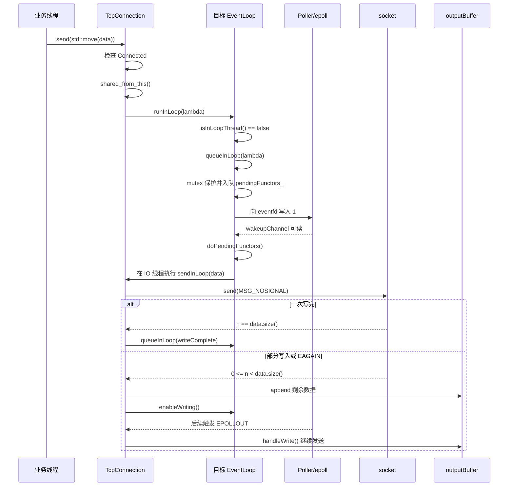

# TcpConnection 发送接口与跨线程调用

## 1. 用户如何调用发送接口

`TcpConnection` 不在应用层手动构造。用户通过 `TcpServer` 注册的回调取得
`TcpConnectionPtr`，再调用公开接口：

```cpp
void send(std::string data);
```

最典型的用法是在消息回调中读取数据并发送：

```cpp
server.setMessageCallback(
    [](const TcpConnectionPtr& conn, Buffer* buffer, Timestamp) {
        // Buffer 只在本次回调期间有效，需要跨事件循环发送时应先取走数据。
        std::string message = buffer->retrieveAllAsString();

        if (conn->connected()) {
            conn->send(std::move(message));
        }
    });
```

如果业务需要在稍后主动推送消息，可以保存 `TcpConnectionPtr`：

```cpp
void onConnection(const TcpConnectionPtr& conn)
{
    if (conn->connected()) {
        connections_[conn->name()] = conn;
        conn->send("welcome\n");
    } else {
        connections_.erase(conn->name());
    }
}
```

用户侧连接表会增加 `TcpConnection` 的引用，断线时必须移除对应表项，否则
连接对象无法正常析构。连接表本身的并发安全也需要由应用处理，`send()` 的
线程切换不会让用户的 `std::unordered_map` 自动变成线程安全容器。

## 2. 为什么 send 接收 string 值

发送接口采用值语义：

```cpp
void TcpConnection::send(std::string data)
{
    if (state_.load() != StateE::Connected) {
        return;
    }

    auto self = shared_from_this();
    loop_->runInLoop(
        [self, data = std::move(data)]() mutable {
            if (self->state_.load() == StateE::Connected) {
                self->sendInLoop(data);
            }
        });
}
```

这段代码同时解决了两个生命周期问题：

1. `self` 是 `shared_ptr<TcpConnection>`，保证任务真正执行前连接对象仍然存活。
2. `data` 由任务按值持有，保证调用方的字符串离开作用域后数据仍然有效。
3. 任务执行时会重新检查连接状态，避免向已经断开的 socket 发送数据。
4. 如果连接在任务执行前已经断开，本次发送会被直接丢弃。

因此，用户可以让局部字符串离开作用域，也可以从业务线程异步发送：

```cpp
auto data = BuildResponse();
conn->send(std::move(data));
```

## 3. 什么情况下会发生跨线程发送

判断标准只有一个：

```cpp
!conn->getLoop()->isInLoopThread()
```

也就是调用 `send()` 的线程不是该 `TcpConnection` 所属的 IO 线程。

### 3.1 当前连接回调向另一条连接发送

这是聊天转发、订阅推送等业务中最常见的场景。

假设 `connA` 属于 IO 线程 1，`connB` 属于 IO 线程 2：

```cpp
void onMessage(const TcpConnectionPtr& connA, Buffer* buffer, Timestamp)
{
    std::string message = buffer->retrieveAllAsString();

    auto connB = findConnection(peerId);
    if (connB && connB->connected()) {
        connB->send(std::move(message));
    }
}
```

该回调运行在线程 1，但 `connB` 的 socket、Channel 和 Buffer 只允许在线程 2
操作，因此这是一次跨线程发送。

### 3.2 业务线程主动推送

订单、RPC、任务线程等非 IO 线程取得连接后发送数据：

```cpp
void onOrderFinished(const TcpConnectionPtr& conn)
{
    conn->send("order finished\n");
}
```

即使主线程负责 accept，连接也可能通过轮询分配到工作 `EventLoop`，所以主线程
调用该连接的 `send()` 同样可能是跨线程调用。

### 3.3 定时器或管理工作线程推送

定时器线程、管理线程、线程池工作线程都只持有连接指针，并不拥有连接所属的
`EventLoop`。这些线程调用 `send()` 时同样需要切换到连接的 IO 线程。

### 3.4 什么情况下不是跨线程

在以下回调中发送当前连接通常不跨线程，因为这些回调已经在连接所属的 IO
线程执行：

```cpp
setConnectionCallback
setMessageCallback
setWriteCompleteCallback
```

例如 Echo 示例在 `onMessage()` 中直接调用：

```cpp
conn->send(std::move(message));
```

此时 `runInLoop()` 检测到当前就在连接所属的 loop 线程，会直接执行任务，不进入
`pendingFunctors_`，也不需要 `eventfd` 唤醒。

## 4. 跨线程发送的完整流程



按代码执行顺序可以概括为：

1. 应用线程调用 `conn->send(std::move(data))`。
2. `send()` 检查连接当前是否为 `Connected`。
3. 通过 `shared_from_this()` 取得连接的强引用 `self`。
4. 数据按值移动进 lambda，连接和数据都由任务持有。
5. 调用 `loop_->runInLoop()` 请求回到连接所属的 IO 线程。
6. 跨线程时，`runInLoop()` 转入 `queueInLoop()`。
7. `queueInLoop()` 在互斥锁保护下把任务加入 `pendingFunctors_`。
8. 如果调用者不在 loop 线程，向 `wakeupFd_` 写入一个 `uint64_t`。
9. `wakeupChannel_` 对应的 eventfd 变为可读，目标线程从 `epoll_wait()` 返回。
10. `EventLoop::handleRead()` 消费 eventfd 计数。
11. 本轮 Channel 事件处理结束后，`doPendingFunctors()` 交换并执行待处理任务。
12. 任务在目标 IO 线程调用 `sendInLoop()`。
13. `sendInLoop()` 尝试直接写 socket；未写出的数据进入 `outputBuffer_`。
14. 输出缓冲未清空时注册 `EPOLLOUT`，由 `handleWrite()` 后续继续发送。

## 5. 为什么需要 eventfd

目标 `EventLoop` 可能正阻塞在 `epoll_wait()` 中。仅仅向
`pendingFunctors_` 添加任务不会让它立刻恢复执行。

`wakeupFd_` 被包装成普通 `Channel` 注册到 epoll。其他线程向 eventfd 写入数据
后，`epoll_wait()` 会返回，并通知 `wakeupChannel_` 可读，目标线程随后才有机会
执行任务队列。

`queueInLoop()` 还会在 `callingPendingFunctors_ == true` 时主动唤醒。这是为了
覆盖另一个边界：loop 已经取出当前任务列表，正在执行回调时又收到新任务；此时
需要留下唤醒通知，确保新任务不会一直等到下一轮普通事件才执行。

## 6. 线程安全边界

允许跨线程调用不等于所有内部状态都可以跨线程访问。

| 操作对象 | 允许访问的线程 | 说明 |
|---|---|---|
| `send()` 公开入口 | 任意线程，建议持有 `TcpConnectionPtr` | 入口只负责状态检查和任务投递 |
| `sendInLoop()` | 所属 IO 线程 | 包含断言并直接操作 socket |
| `Channel` | 所属 IO 线程 | 修改 epoll 关注事件和移除 Channel 都必须在 loop 线程 |
| `inputBuffer_` / `outputBuffer_` | 所属 IO 线程 | 由读写回调串行访问 |
| 用户连接表 | 由应用决定 | `send()` 不会替用户保护连接表 |

核心不变量是：

> 连接对象可以被其他线程持有，但连接状态、Channel、Buffer 和 socket 操作
> 只能在所属 EventLoop 线程执行。

## 7. 部分写与写完成语义

非阻塞 socket 不保证一次 `send()` 写完全部数据。当前实现的处理是：

1. 没有积压数据时先直接写 socket。
2. `n == data.size()` 表示本次数据已全部交给内核。
3. `0 <= n < data.size()` 表示发生部分写，剩余数据追加到 `outputBuffer_`。
4. 非阻塞写返回 `EAGAIN` 或 `EWOULDBLOCK` 时，数据同样进入输出缓冲区。
5. 注册 `EPOLLOUT`，等到内核发送缓冲区重新可写后继续刷新。
6. 输出缓冲区清空后关闭写事件监听，并投递写完成回调。

`WriteCompleteCallback` 表示连接的输出缓冲区已经清空，数据已经交给本机内核，
不表示客户端应用已经接收或处理了数据。

## 8. 面试回答

可以用下面的表述概括：

> `TcpConnection` 只对用户公开 `send()`，用户通过回调取得
> `TcpConnectionPtr` 后调用它。`send()` 接收 `std::string` 值，并在跨线程时把
> 数据移动进任务，同时捕获 `shared_ptr<TcpConnection>`，解决对象和数据的
> 生命周期问题。公开入口通过 `runInLoop()` 判断当前线程；如果调用线程不是连接
> 所属的 IO 线程，就进入 `queueInLoop()`，在锁保护下加入待处理队列，并写入
> eventfd 唤醒目标 loop。目标线程在 `doPendingFunctors()` 中执行 `sendInLoop()`，
> 那里才真正访问 socket 和输出缓冲区。部分写或 `EAGAIN` 时，剩余数据进入
> `outputBuffer_`，注册 `EPOLLOUT` 后继续发送。

## 9. 相关代码

- `include/my_muduo/net/TcpConnection.h`：公开 `send()` 与 `shutdown()`。
- `src/net/TcpConnection.cc`：发送、部分写、关闭和断线状态检查。
- `src/net/EventLoop.cc`：`runInLoop()`、`queueInLoop()`、eventfd 唤醒和任务执行。
- `src/net/TcpServer.cc`：主 loop 接收连接并把连接建立任务投递到工作 loop。
- `examples/echo_server.cpp`：在消息回调中调用 `conn->send()` 的示例。
